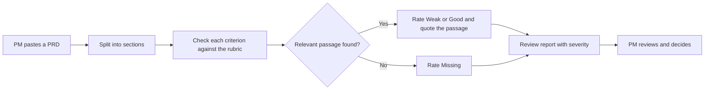
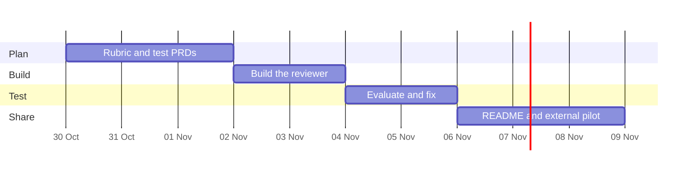

# PRD: PRD Reviewer

Status: Draft v0 | Owner: Swet Nisha | Date: 2026-10-30

## 1. Problem statement
PRDs often reach engineering without success metrics, a named user, non-goals or risks, and these gaps surface late. Full reasoning is in [problem-statement.md](problem-statement.md). The evidence so far is hypothesis only, and I will collect feedback from 3 external reviewers to test it.

## 2. Target user
Primary: junior and mid-level PMs who write PRDs without a senior PM nearby to review them. Secondary: product leads who review many PRDs.

## 3. Success metrics

| Metric | Baseline | Target | By |
| --- | --- | --- | --- |
| Detection rate on test PRDs with one element removed | not yet measured | at least 80% | 5 Nov |
| Findings that quote evidence from the PRD | not yet measured | 100% | 5 Nov |
| Time to return a review | not yet measured | under 60 seconds | 5 Nov |
| Usefulness rating from external reviewers | none yet | at least 3 of 3 find it useful | 8 Nov |

## 4. Scope and requirements

Must-have (v1):
- Accept a PRD as pasted text or Markdown.
- Rate each rubric criterion as Missing, Weak or Good, with a severity (see [rubric.md](rubric.md)).
- Quote the passage each finding refers to, or state that the section is absent.
- Return the report in under 60 seconds.

Later: PDF upload, a consistency check between the problem and the metrics.

How it works:

## 5. Non-goals
- Rewriting the PRD: the tool flags problems and the PM fixes them.
- Judging whether the product idea is good: it checks structure and clarity only.
- Storing uploaded documents: this protects confidential material.
- Integrations such as Jira: not needed to prove the concept.

## 6. Risks and dependencies
- False positives reduce trust. Mitigation: severity levels, "Not applicable" for small changes and mandatory evidence quotes.
- Users may paste confidential PRDs. Mitigation: nothing is stored and the interface shows a warning.
- Depends on the Anthropic API for analysis. Fallback: cache results for the demo so it still works if the API is unavailable.

## 7. Rollout plan
Phase 1: public GitHub repo with a local demo. Phase 2: 3 external reviewers try it on public PRDs. Phase 3: share more widely on LinkedIn only if detection is at least 80%. There is no hosted service in v1, so rollback is simply taking the repo private.

## 8. Open questions

| Question | Owner | Decide by |
| --- | --- | --- |
| Is 9 criteria too many for a first version? | Swet | 2 Nov |
| Which model gives the best quality for the cost? | Swet | 3 Nov |
| Can I find 3 external reviewers? | Swet | 4 Nov |

## 9. Timeline and milestones
Tasks are tracked on the repo's GitHub Project board.

